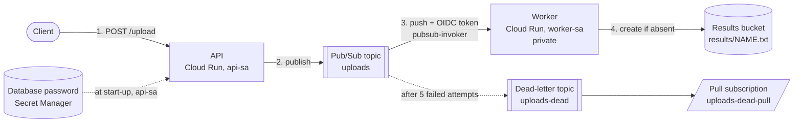

# Architecture

An upload API and a worker, each a Cloud Run service with its own service account, joined by a Pub/Sub push subscription that authenticates with an OIDC token from a third account. A message that keeps failing lands in a dead-letter topic. Everything is defined in Terraform; the application is a small layered Python package.

## Components

| Component | Owns | Identity |
| --- | --- | --- |
| **API** (`uploads.interfaces.api`, Cloud Run service `api`) | `POST /upload`: validates the name, publishes one message, answers `202`. `GET /health`: whether `DB_PASSWORD` arrived, never its value. | `api-sa`: `pubsub.publisher` on the `uploads` topic, `secretmanager.secretAccessor` on the `db-password` secret. No project-level role. |
| **Worker** (`uploads.interfaces.worker`, Cloud Run service `worker`) | `POST /`: decodes the Pub/Sub push envelope, writes `results/<name>.txt` once, answers `204`, or an error status so Pub/Sub retries. Private: no unauthenticated access. | `worker-sa`: `storage.objectCreator` on the results bucket. |
| **Uploads topic** and **push subscription** (`modules/pubsub-push`) | Delivery to the worker with retries and exponential backoff; the dead-letter policy (5 attempts). | The subscription sends an OIDC token for `pubsub-invoker`. |
| **Dead-letter topic** and its **pull subscription** | The messages that failed 5 times, kept 7 days so they can be read and replayed. | The Pub/Sub service agent publishes to it. |
| **Invoker account** `pubsub-invoker` | Exists only so Pub/Sub can call the worker. | `run.invoker` on the worker service only. |
| **Database password** (secret `db-password`, `modules/secret`) | The throwaway database password in Secret Manager, injected into the API as an environment variable by Cloud Run. | Read by `api-sa` only. |
| **Results bucket** (`modules/results-bucket`) | The result files. Private, uniform access, versioned, 30-day retention. | Written by `worker-sa` only. |
| **Artifact Registry** (`modules/artifact-registry`) | The two container images (immutable tags). | Pushed by the owner running `scripts/build-images.sh`. |
| **Project baseline** (`modules/project-baseline`) | The APIs, the budget alert, the optional organization policy against service account keys. | None. |

## Data flow



One request, end to end:

1. The client posts `{"name": "report-1"}` to the API. The API validates the name (letters, digits, `.`, `_`, `-`; no path characters) and returns `400` for anything else.
2. The API publishes `{"name":"report-1"}` to the `uploads` topic, waits for the broker's acknowledgement within a deadline (`PUBLISH_TIMEOUT_SECONDS`, default 10), and answers `202` with the message id. A broker failure is `503`, and the cause (for example a missing publisher role) is logged at `ERROR`.
3. Pub/Sub pushes the message to the worker's URL with an `Authorization: Bearer` token minted for `pubsub-invoker`. Cloud Run checks the token's signature, audience and the account's `run.invoker` binding before the request reaches the container; a call without a token gets `403`.
4. The worker decodes the envelope and the message, then creates `results/report-1.txt` with `ifGenerationMatch=0` (only if absent). Created or already there, it answers `204`, which acknowledges the message.
5. If the write fails (for example `storage.objects.create` is denied), the worker logs the full error text at `ERROR` and answers `500`. Pub/Sub retries with backoff (10 s to 120 s); after the fifth failed attempt it publishes the message to `uploads-dead`, where `uploads-dead-pull` keeps it for a replay.

## Pattern: ports and adapters

The package `uploads` has four layers, enforced by import-linter in `make lint` (the dependency rule is a test, not a convention):

```text
interfaces      Flask apps, the Pub/Sub envelope, gunicorn settings, the two entry points
infrastructure  Pub/Sub publisher, Cloud Storage store, settings from the environment, JSON logging
application     RequestUpload, ProcessUpload, and the two ports (MessagePublisher, ResultStore)
domain          UploadName, UploadRequested, UploadResult, named errors
```

The lesson has two outward boundaries (a broker and an object store), so each is a port with a real adapter and an in-memory fake. That is what makes every test of the use cases run without Google Cloud, and why the integration tests can run the same adapters against emulators. Flask and the Google libraries appear only in the two upper layers.

## Decisions and trade-offs

| Decision | Why | Cost |
| --- | --- | --- |
| **Push subscription to a private Cloud Run service**, not a pull worker | Cloud Run scales to zero and wakes on a request; there is no process polling the subscription. The identity story (OIDC token, invoker role) is the lesson. | Throughput is bounded by Cloud Run's concurrency and the ack deadline; a long job needs the pull model or Cloud Tasks. |
| **Three service accounts**, roles on resources, none on the project | A compromised API can publish and read one secret, nothing else. `scripts/prove.sh` and `tests/unit/test_infrastructure_policy.py` check there is no project-level binding. | More resources to create; `iam.serviceAccounts.actAs` is needed to wire them, which only the deployer holds. |
| **`objectCreator` plus create-if-absent** | `objectCreator` cannot read, overwrite or delete, so a worker bug cannot damage existing results. Overwriting needs `storage.objects.delete`, so a naive write of a duplicate delivery would be denied; `ifGenerationMatch=0` turns a duplicate into a harmless no-op. | The worker cannot update a result. For that, grant `objectUser` on the bucket and decide on the overwrite rule. |
| **`5xx` for storage failure, `400` for an unusable message** | Pub/Sub acknowledges only 2xx. Answering `200` after an error loses the message. A malformed message also gets a non-2xx so it is dead-lettered and visible instead of acknowledged and forgotten. | A poison message is attempted 5 times before it reaches the dead-letter topic. |
| **Five attempts, 10 s to 120 s backoff** | The lesson's break-it step finishes in minutes. Production would pick the attempt count from how long a downstream outage lasts. | A transient outage longer than the retry window dead-letters good messages; replay them. |
| **Secret as a Cloud Run environment variable** | The lesson's mechanism; Cloud Run reads it with the service's own identity at start-up. | The value is fixed per revision; a rotated secret needs a new revision. Mounting it as a file picks up new versions. |
| **Write-only secret value, ephemeral variable** | The password never enters the Terraform state or plan, so state needs no special protection for it. | Needs Terraform 1.11 or newer and a provider with `secret_data_wo`. |
| **Two apply passes** (placeholder image, then yours) | A Cloud Run service needs an image that exists; the Artifact Registry repository is created by the same configuration. | `scripts/deploy.sh` hides the two passes; a CI/CD pipeline would build first in a separate project. |
| **Member maps keyed by fixed labels** (`{ worker = module.worker_sa.member }`) | `for_each` keys must be known at plan time; the members are known only after apply. | Callers name each member. |
| **Local state**, an `.example` for the GCS backend | A one-day sandbox. | No locking and no sharing; see "Limits" below. |
| **One image definition, two targets** | One lock file and one build for two entry points. | Both images contain both services' code; the entry point decides what runs. |

## Failure modes the lesson teaches and where the code shows them

| Failure | What happens | Where to see it |
| --- | --- | --- |
| Service deployed without `--service-account` | Runs as the default compute account, often with `Editor`; step 2's narrow roles do nothing. | `modules/cloud-run-service` requires `service_account_email`; a test asserts it is set. |
| Broad role "to make it work" | The break in step 5 shows nothing because the worker works either way. | `tests/unit/test_infrastructure_policy.py` rejects `storage.admin`, `editor`, `owner` and project-level bindings. |
| Public worker | Anyone can post a fake message. | The worker has no `allUsers` binding; only `pubsub-invoker` has `run.invoker`; `terraform test` asserts it; `scripts/prove.sh` calls the URL and expects `403`. |
| Missing Pub/Sub service agent grants | Messages retry and never reach the dead-letter topic. | `modules/pubsub-push` grants publisher on the dead-letter topic, subscriber on the push subscription, and token creator on the invoker; a test asserts the first two. |
| `200` after an error | The message is lost, nothing is dead-lettered. | `tests/unit/interfaces/test_worker.py::test_a_failing_write_answers_500_never_2xx_and_logs_the_denial`. |
| Role removed from the worker | `403` from Cloud Storage naming the account, the permission and the resource, retries, dead letter. | `tests/e2e/test_lesson_scenario.py` rehearses retry, dead letter and replay against emulators; `scripts/break-permission.sh` does it for real. |
| Duplicate delivery | At-least-once delivery repeats a message. | `ProcessUpload` returns `ALREADY_PROCESSED`; tested in unit, integration (real adapter) and end to end. |
| Secret has no version | Cloud Run refuses to start the revision. | `modules/secret` writes the first version before the API is created (`depends_on` in the environment). |

## Limits of the teaching build against a production one

- One region, one project, local Terraform state. A production setup keeps the state in a locked bucket, splits projects per environment, and applies from a pipeline.
- The API is public and unauthenticated because the exercise says so (`api_public = true`). Production puts it behind a load balancer with Cloud Armor, or requires an identity token (`api_public = false`).
- Google-managed encryption on topics, the repository and the bucket. The `gke-identity-and-keys` project is where customer-managed keys appear. The checkov skips in the modules say so.
- No access-log bucket and no alerting policy on dead-letter depth; both are the first things to add.
- Results expire after 30 days; the lesson does not say, a real retention rule comes from the data's owner.
- The emulators do not check OIDC tokens or IAM, so the `403` on the worker and every permission denial need the real project (`scripts/prove.sh`); the emulators prove the delivery, retry, dead-letter and replay logic.

## Extending it

- **Eventarc instead of the push subscription** (stretch 1): replace `modules/pubsub-push` with an Eventarc trigger; the trigger has its own service account and its own retry behavior, and the worker's envelope parser would read a CloudEvent.
- **A custom role for the worker** (stretch 2): add `google_project_iam_custom_role` with only `storage.objects.create`, and bind it on the bucket in place of `objectCreator`. `tests/unit/test_infrastructure_policy.py` allows project-level custom roles only if you edit its allow-list on purpose.
- **A load balancer with Cloud Armor** (stretch 3): add a module with a serverless NEG for `api`, a security policy with a rate-limit rule, and set `ingress = "INGRESS_TRAFFIC_INTERNAL_LOAD_BALANCER"` on the API.
- **Another result type**: add a use case in `application`, a port if it needs a new boundary, and route it from `interfaces`; the layers tell you where each piece goes.
